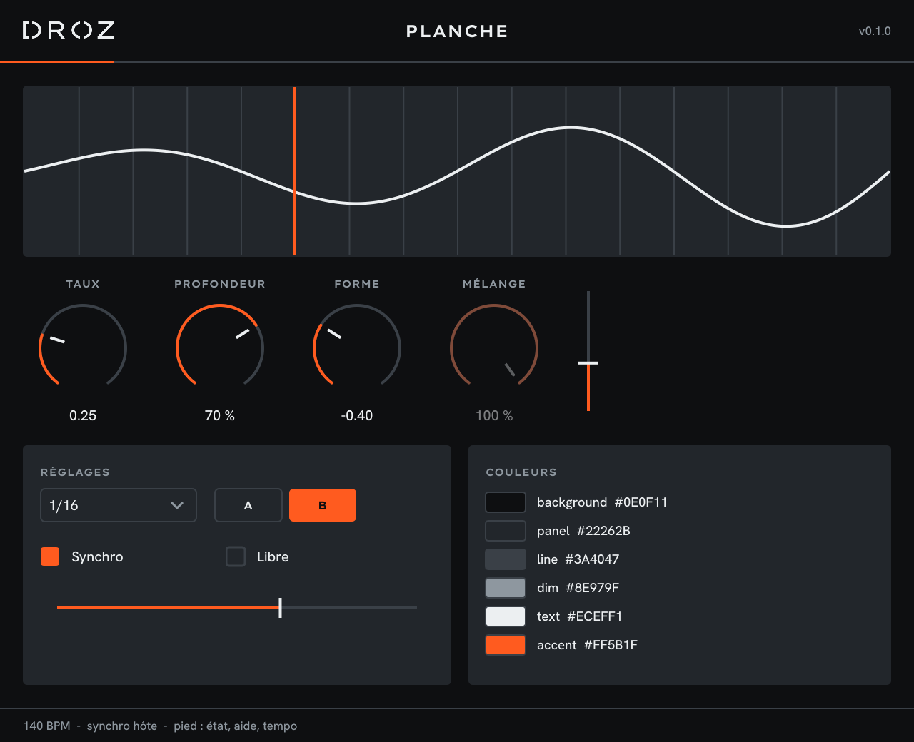

# Habillage des plugins Droz

Tous les plugins Droz se ressemblent : meme fond, memes polices, memes controles, meme en-tete. Ce qui distingue un plugin, c'est son nom et son visuel anime, pas ses couleurs.

Tout est dans `libs/droz_ui/include/droz/ui.h` (`droz::ui`). La planche ci-dessous montre chaque brique.



## La regle

L'habillage Droz est obligatoire pour tous les plugins du depot, quel que soit l'auteur : a la creation, et a chaque mise a jour.

- Un plugin se monte avec `droz::ui`. Pas de couleur, de police ni de controle dessine en dehors.
- Un plugin plus ancien, pas encore a la charte, y passe a sa prochaine mise a jour.
- Une envie differente (autre couleur, autre police, nouveau controle) se propose pour tout le monde dans une PR `commun:`. Pas d'exception dans un seul plugin.
- `python tools/droz.py verifier` liste les plugins qui s'en ecartent.

## D'ou ca vient

L'artwork Droz Recordz (Drive DROZ RECORDZ > Communication > Charte Graphique) : une toile ardoise bleu-noir, de l'ecume blanche, des coulees rouge-orange, et le logo blanc en capitales larges et espacees.

Donc : sombre, texte blanc glace, traits fins, et le rouge-orange comme seule couleur vive.

## Couleurs

| Nom | Valeur | Usage |
|---|---|---|
| `background` | #0B1219 | fond de la fenetre |
| `panel` | #1A2732 | cadres, menus, fond du visuel |
| `line` | #283C47 | filets, pistes des potards et curseurs, etat eteint |
| `dim` | #8FA1AD | libelles, texte secondaire |
| `text` | #EDF3F6 | texte, reperes, matiere du visuel |
| `accent` | #F0431F | valeur d'un controle, etat allume, tete de lecture |

- Aucune autre couleur dans un plugin, aucune couleur ecrite en dur. Un besoin qui revient s'ajoute dans `ui.h` par une PR `commun:`.
- Le rouge-orange veut dire "ca joue" ou "c'est regle ici". Jamais en decoration, jamais en fond.
- Controle desactive : meme dessin a 35 % d'opacite.

## Polices

Deux polices libres (SIL OFL), embarquees dans chaque plugin : le rendu est le meme sur Windows, Mac et Linux.

| Fonction | Police | Tailles | Usage |
|---|---|---|---|
| `caps(taille)` | Michroma | 15 nom du plugin, 11 "DROZ", 10 boutons, 9 libelles | titres et libelles courts, toujours en capitales avec `upper()` |
| `mono(taille)` | IBM Plex Mono | 13 valeurs et menus, 11 pied et version | valeurs, menus, textes |

- Libelle d'un controle : un mot, deux au plus.
- Texte accentue : `juce::String::fromUTF8`, et `droz::ui::upper` pour les capitales.

## Mesures

Grille de 4 pixels. Les valeurs sont dans `droz::ui::metrics`.

| Nom | Valeur | |
|---|---|---|
| `header` | 44 | en-tete |
| `footer` | 24 | pied |
| `margin` | 16 | bord de la fenetre |
| `gap` | 12 | entre deux controles |
| `knobWidth` x `knobHeight` | 84 x 108 | un potard avec libelle et valeur |
| `row` | 24 | bouton, menu, curseur horizontal |
| `stroke` | 2 | arcs, pistes, courbes |
| `corner` | 3 | arrondi des cadres |

## Composition d'une fenetre

De haut en bas :

1. En-tete : `drawHeader (g, zone, nom, version)`. "DROZ" a gauche, nom au centre sans le prefixe "Droz", version a droite.
2. Visuel anime, sur toute la largeur : c'est lui qui donne son caractere au plugin.
3. Une rangee de potards. 4 a 6 reglages en facade, pas plus.
4. Reglages secondaires dans un cadre : `drawPanel (g, zone, titre)`.
5. Pied : `drawFooter (g, zone, texte)`. Une ligne : etat, aide ou tempo.

Fenetre redimensionnable, taille gardee dans l'etat. Pour un ratio fixe : `scaleFor` et la lecon "ratio fixe" de `docs/PIEGES.md`.

## Controles

| Besoin | Brique |
|---|---|
| Reglage continu | `droz::ui::Knob` (libelle, valeur, info-bulle), a relier par un `SliderAttachment` sur `.slider` |
| Reglage continu en ligne | `juce::Slider` en `LinearHorizontal` ou `LinearVertical` |
| Choix dans une liste | `juce::ComboBox` |
| Oui / non | `juce::ToggleButton` |
| Action, ou choix A/B | `juce::TextButton` (allume = plein rouge-orange) |
| Visuel anime | deriver `droz::ui::Visual` et dessiner dans `draw()` |

- Un seul `droz::ui::LookAndFeel` par editeur, pose avec `setLookAndFeel` apres avoir ajoute les controles, retire dans le destructeur.
- Info-bulle sur chaque controle (un `juce::TooltipWindow` dans l'editeur), double-clic = valeur par defaut.
- `plugins/_modele` montre le montage minimal.

## Visuel anime

- 30 images par seconde, a l'arret quand la fenetre est cachee : `Visual` s'en charge.
- Matiere en blanc et gris (courbe, grille, pas). Rouge-orange pour ce qui bouge ou joue.
- Traits de 2 pixels, pas de degrade, pas d'ombre, pas d'image.
- Le visuel montre ce que fait le son (le rythme, la forme, le niveau), pas une decoration.
- Il lit ses valeurs par `std::atomic`, jamais de verrou ni d'attente cote audio.

## Changer l'habillage

PR `commun:`, relue par un autre membre, avec la planche refaite :

```
cmake -S . -B build -DDROZ_PLANCHE=ON
cmake --build build --target droz_ui_planche
xvfb-run -a <chemin>/droz_ui_planche docs/habillage.png
```

`xvfb-run` : Linux seulement. Sur Windows et Mac, lancer le programme directement.
